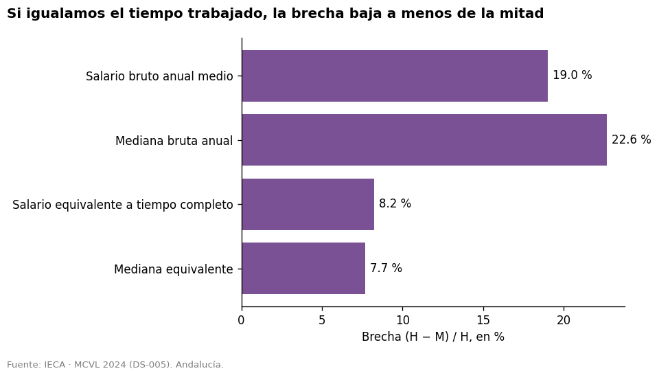
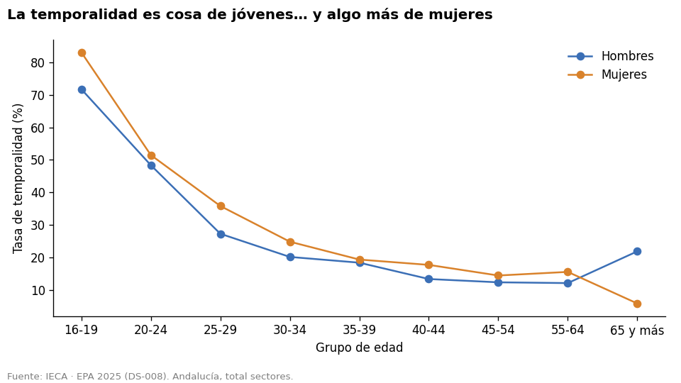
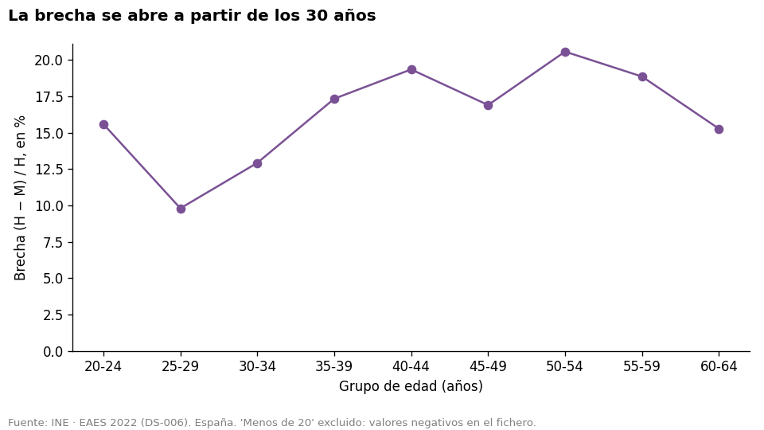
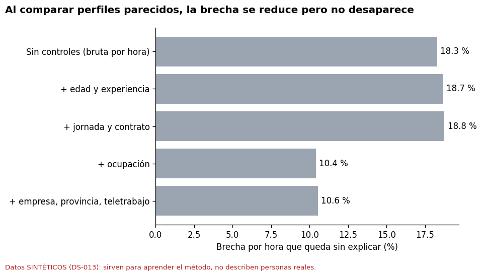

# Datatón Tech for Good · InnoSoft 26–27 · Guía de aprendizaje

> **¿Cuánto vale tu trabajo? Y cuánto vale el de la persona de al lado.**
> *Los datos no son neutrales.*

Esta es la **guía práctica** del datatón: todo lo que necesitas saber para analizar la **brecha salarial por género, edad y temporalidad en el sector tecnológico andaluz**, explicado **desde cero**. No hace falta haber programado nunca.

- 📜 **Bases oficiales** (fechas, rúbrica, premios, catálogo completo): [`docs/BASES_DATATON.md`](docs/BASES_DATATON.md)
- 🎞️ **Presentación de la fase de aprendizaje**: [`presentacion/Dataton_fase_aprendizaje.pdf`](presentacion/Dataton_fase_aprendizaje.pdf)
- 📤 **Formulario de entrega** (antes de las **18:15**): <https://forms.gle/z2CNdi5BManDt7A6A> · instrucciones en la [sección 12](#12-entregables-cómo-entregar-y-checklist-final)
- 🌐 **Web del datatón**: <https://innosoft-igualdad-sostenibilidad.vercel.app/>

---

## Índice

0. [Cómo usar este repositorio](#0-cómo-usar-este-repositorio)
1. [El reto en un minuto](#1-el-reto-en-un-minuto)
2. [Prepara tu entorno (5 min)](#2-prepara-tu-entorno-5-min)
3. [Conceptos de datos desde cero](#3-conceptos-de-datos-desde-cero)
4. [Python y pandas: lo mínimo](#4-python-y-pandas-lo-mínimo)
5. [Estadística que vas a usar](#5-estadística-que-vas-a-usar)
6. [La brecha salarial: cómo se mide](#6-la-brecha-salarial-cómo-se-mide)
7. [Las trampas de estos datos](#7-las-trampas-de-estos-datos)
8. [Modelar: explicar y predecir](#8-modelar-explicar-y-predecir)
9. [Visualizar y contar](#9-visualizar-y-contar)
10. [Eficiencia: InnoSoft Reciclator](#10-eficiencia-innosoft-reciclator)
11. [El día, fase a fase](#11-el-día-fase-a-fase)
12. [Entregables, cómo entregar y checklist final](#12-entregables-cómo-entregar-y-checklist-final)
13. [Chuleta de código](#13-chuleta-de-código)
14. [Cuando algo falla](#14-cuando-algo-falla)

---

## 0. Cómo usar este repositorio

```text
.
├── README.md                     ← esta guía
├── requirements.txt              ← librerías necesarias
├── presentacion/                 ← diapositivas de la fase de aprendizaje (PDF)
├── docs/
│   ├── BASES_DATATON.md          ← bases oficiales del datatón
│   └── img/                      ← gráficos de ejemplo que usa esta guía
├── datos/
│   ├── csv/                      ← los 15 datasets (DS-001 … DS-015), ya descargados
│   └── descargar_datos.py        ← vuelve a descargarlos si cambian
├── notebooks/                    ← el material de aprendizaje, en orden
│   ├── 00_python_desde_cero.ipynb
│   ├── 01_fase1_eda.ipynb
│   ├── 02_fase2_indicadores_y_modelo.ipynb
│   └── 03_fase3_visualizar_y_contar.ipynb
├── plantilla/                    ← punto de partida para tu entrega
│   ├── plantilla_entrega.ipynb
│   └── guion_diapositivas.md
└── src/
    └── dataton.py                ← funciones reutilizables (leer, brecha, cronómetro…)
```

**Ruta recomendada:**

| Si… | Empieza por |
|---|---|
| Nunca has programado | `notebooks/00_python_desde_cero.ipynb` (20 min) y después el 01 |
| Sabes algo de Python pero no de pandas | La sección 4 de esta guía y el notebook 01 |
| Ya sabes pandas | Lee la sección 7 (trampas), abre la plantilla y a por tu pregunta |

---

## 1. El reto en un minuto

Vamos a responder **preguntas concretas y honestas** sobre la desigualdad salarial usando **datos públicos oficiales** (IECA, INE, AEAT, Seguridad Social).

Cuatro ejes:

| Eje | Cifra de partida | Dataset principal |
|---|---|---|
| **Género** | Brecha del **19,0 %** en salario bruto, **8,2 %** a igual jornada (Andalucía 2024) | DS-005 |
| **Edad** | La brecha se abre a partir de los 30 años | DS-004, DS-006 |
| **Temporalidad** | La **mitad** de los asalariados de 20–24 años tiene contrato temporal | DS-008, DS-015 |
| **Sector TIC** | Solo un **26,6 %** del empleo TIC andaluz son mujeres | DS-003, DS-011 |

> 💡 **La brecha de datos.** No existe ninguna tabla oficial que cruce sexo × edad × temporalidad × salario dentro del sector TIC andaluz. **Detectar y documentar lo que falta también es un resultado.** El cruce que no existe no se inventa: se declara.

**Qué se entrega:** un notebook que se ejecute, un CSV de resultados y 3–4 diapositivas en PDF, con un pitch de 2 minutos. **Qué se valora:** que funcione (30 %), que cuente algo que importa (25 %), que se entienda (20 %), que sea eficiente (15 %), que se entregue bien (10 %).

---

## 2. Prepara tu entorno (5 min)

Tienes dos opciones. **Si dudas, usa Google Colab**: no hay que instalar nada.

### Opción A · Google Colab (recomendada)

1. Entra en <https://colab.research.google.com> con una cuenta de Google.
2. **Archivo → Subir cuaderno** y elige un `.ipynb` de la carpeta `notebooks/` (o `plantilla/`).
3. Ejecuta la primera celda (`Shift + Enter`). Los notebooks **descargan los datos solos** desde la web del datatón.

> 📤 **Haz esto también en la acogida:** elegid quién del equipo subirá la entrega y que abra el [formulario de entrega](https://forms.gle/z2CNdi5BManDt7A6A) para comprobar que puede iniciar sesión. Mejor descubrir un problema a las 15:35 que a las 18:14.

### Opción B · En tu ordenador

1. Instala **Python 3.10 o superior** desde <https://www.python.org/downloads/> (en Windows, marca *"Add Python to PATH"*).
2. Abre una terminal **en la carpeta de este repositorio** e instala las librerías:

```bash
pip install -r requirements.txt
```

3. Abre Jupyter:

```bash
jupyter lab
```

4. Se abrirá el navegador. Entra en `notebooks/` y abre el primero.

> Los CSV ya están en `datos/csv/`, así que en local **funciona sin internet**.

### ¿Qué es un notebook?

Un documento hecho de **celdas**: unas tienen texto y otras código que se ejecuta con `Shift + Enter`. El resultado aparece justo debajo. Importante: el notebook recuerda lo que has ejecutado **en el orden en que lo ejecutaste**. Si te pierdes: **Kernel → Restart & Run All**.

---

## 3. Conceptos de datos desde cero

### 3.1 · Una tabla de datos

Casi todo en análisis de datos es una **tabla**:

| sexo | edad | contrato | salario |
|---|---|---|---|
| Mujer | 25 | Temporal | 18.000 |
| Hombre | 31 | Indefinido | 26.000 |

- Cada **fila** es una **observación** (una persona, una provincia, un grupo…).
- Cada **columna** es una **variable** (una característica medida).

### 3.2 · Tipos de variables

| Tipo | Qué es | Ejemplos | Qué se puede hacer |
|---|---|---|---|
| **Numérica** | Un número con sentido de cantidad | salario, edad, horas | media, mediana, sumar, restar |
| **Categórica** | Una etiqueta | sexo, provincia, ocupación | contar, agrupar, comparar grupos |
| **Ordinal** | Categoría con orden | grupo de edad (16-29 < 30-44 < 45-64) | ordenar, agrupar |

### 3.3 · Microdatos vs. datos agregados

Esta distinción es **clave** en este datatón:

| | **Microdatos** | **Agregados** |
|---|---|---|
| Cada fila es… | una persona | un grupo (p. ej. "mujeres de 30-39 en Andalucía") |
| Ejemplo | DS-013 (sintético) | DS-004, DS-005, DS-008… |
| Permite… | modelos, cruzar cualquier variable | solo los cruces que publica la fuente |
| Riesgo | privacidad (por eso los nuestros son **sintéticos**) | no puedes "deshacer" la media para ver personas |

⚠️ **Nunca infieras salarios individuales a partir de medias.** Que la media de un grupo sea 24.000 € no dice cuánto cobra ninguna persona concreta.

### 3.4 · Población, muestra y fuente

- **Población:** todas las personas sobre las que quieres hablar (todos los asalariados andaluces).
- **Muestra:** las que se han observado de verdad. La **EPA** es una encuesta a hogares; la **MCVL** es una muestra de registros de la Seguridad Social. Por eso hay **error de muestreo**: los grupos pequeños (una provincia, mujeres de 65+) tienen cifras menos fiables.
- **Fuente:** quién mide y cómo. **IECA, INE y AEAT miden cosas distintas**: periodo, territorio, definición de salario y de sector. No se comparan directamente sin decirlo.

### 3.5 · Stock vs. flujo

- **Stock:** cuántas personas tienen un contrato temporal **hoy** (EPA, DS-008).
- **Flujo:** cuántos contratos temporales **se firman** en un periodo (SEPE).

Un contrato de una semana pesa muy poco en el stock y mucho en el flujo. **No los mezcles.**

### 3.6 · El formato CSV

Un **CSV** es un fichero de texto donde cada línea es una fila. Los de este datatón usan formato español:

```text
sexo;asalariados;salario_bruto_anual;...
Hombres;1.835.875,00;21.103,00;...
```

| Elemento | En estos CSV | Lo que Python espera por defecto |
|---|---|---|
| Separador de columnas | `;` | `,` |
| Decimal | `,` | `.` |
| Miles | `.` | nada |
| Codificación | UTF-8 con BOM | UTF-8 |
| Dato no disponible | celda vacía o `.` | celda vacía |

Por eso **hay que decirle a pandas cómo leerlos** (sección 4.3).

---

## 4. Python y pandas: lo mínimo

> Práctica guiada: [`notebooks/00_python_desde_cero.ipynb`](notebooks/00_python_desde_cero.ipynb)

### 4.1 · Python en 10 líneas

```python
salario_h = 21103                     # variable: un nombre para un valor
salario_m = 17093
brecha = (salario_h - salario_m) / salario_h
print(f"Brecha: {brecha:.1%}")        # f-string con formato -> "Brecha: 19.0%"

grupos = ["16-29", "30-44", "45-64"]  # lista
salarios = {"Hombres": 21103, "Mujeres": 17093}  # diccionario (clave -> valor)

def calcula_brecha(h, m):             # función: código reutilizable
    return (h - m) / h
```

Recuerda: en Python el decimal es un **punto** (`19.5`) y la **sangría** (4 espacios) indica qué va dentro de una función, un `for` o un `if`.

### 4.2 · Las tres librerías

| Librería | Para qué | Importación |
|---|---|---|
| **pandas** | Tablas: leer, filtrar, agrupar | `import pandas as pd` |
| **matplotlib** | Gráficos | `import matplotlib.pyplot as plt` |
| **scikit-learn** | Modelos | `from sklearn.linear_model import LinearRegression` |

### 4.3 · Leer los datos (la parte que más falla)

```python
import pandas as pd

URL_BASE = "https://innosoft-igualdad-sostenibilidad.vercel.app/data/csv/"

def leer(nombre):
    return pd.read_csv(
        URL_BASE + nombre,
        sep=";",               # columnas separadas por punto y coma
        decimal=",",           # 27,5 -> 27.5
        thousands=".",         # 1.835.875 -> 1835875
        encoding="utf-8-sig",  # quita el BOM del nombre de la primera columna
        na_values=["."],       # el INE usa "." para "no disponible" (DS-002)
    )

salarios = leer("DS-005_salario_sexo_andalucia_2024.csv")
```

> ⚠️ Si te olvidas de `thousands="."`, los salarios se leen como **texto** y nada funciona. Si te olvidas de `na_values=["."]`, la columna de salarios de DS-002 entera se lee como texto.

Los notebooks usan una versión de `leer()` que primero busca el fichero en `datos/csv/` (sin internet) y, si no está, lo descarga.

### 4.4 · Mirar, filtrar, agrupar

| Quiero… | Código |
|---|---|
| Ver las primeras filas | `df.head()` |
| Saber cuántas filas y columnas | `df.shape` |
| Ver nombres y tipos de columnas | `df.dtypes` o `df.info()` |
| Resumen estadístico | `df.describe()` |
| Contar huecos por columna | `df.isna().sum()` |
| Una columna | `df["salario"]` |
| Filtrar filas | `df[df["sexo"] == "Mujeres"]` |
| Filtrar con varias condiciones | `df[(df["edad"] > 30) & (df["contrato"] == "Temporal")]` |
| Contar categorías | `df["sexo"].value_counts()` |
| Media por grupo | `df.groupby("sexo")["salario"].mean()` |
| Varias medidas por grupo | `df.groupby("sexo")["salario"].agg(["mean", "median", "count"])` |
| Tabla cruzada (proporciones) | `pd.crosstab(df["ocupacion"], df["sexo"], normalize="columns")` |
| De formato largo a ancho | `df.pivot(index="grupo_edad", columns="sexo", values="tasa")` |
| Columna nueva | `df["mensual"] = df["salario"] / 12` |

---

## 5. Estadística que vas a usar

> Práctica guiada: [`notebooks/01_fase1_eda.ipynb`](notebooks/01_fase1_eda.ipynb)

### 5.1 · Media vs. mediana

Imagina 5 personas que cobran 18, 20, 22, 24 y **90** mil euros.

- **Media** = (18 + 20 + 22 + 24 + 90) / 5 = **34,8 mil**. Nadie cobra eso.
- **Mediana** = el valor del medio al ordenarlas = **22 mil**. Representa a la persona típica.

Los salarios tienen **cola larga a la derecha** (pocos sueldos muy altos), así que la **media es mayor que la mediana**. 👉 **Compara siempre las dos.**

En Andalucía 2024 (DS-005): la brecha en la **media** bruta es del 19,0 %, pero en la **mediana** bruta del **22,6 %**. La desigualdad golpea más a la mitad baja.

### 5.2 · Percentiles

El **percentil 25 (P25)** es el valor por debajo del cual está el 25 % de las personas. P50 = mediana, P75 = tercer cuartil. Comparar P10 o P25 entre hombres y mujeres dice qué pasa **en los sueldos bajos**; P90, **en los altos** (el famoso *techo de cristal*).

### 5.3 · Tasas, porcentajes y puntos porcentuales

- **Tasa de temporalidad** = asalariados temporales / total de asalariados × 100.
- Si la temporalidad pasa del 20 % al 25 %, sube **5 puntos porcentuales (pp)** o un **25 %**. No es lo mismo: di siempre cuál usas.

### 5.4 · Correlación no es causalidad

Que dos cosas vayan juntas no significa que una cause la otra. Que las mujeres cobren menos de media **no demuestra por sí solo discriminación**; que lo expliquen la jornada o la ocupación **tampoco demuestra que no la haya**. Los datos describen; la interpretación hay que justificarla.

---

## 6. La brecha salarial: cómo se mide

### 6.1 · Dos fórmulas

$$\text{Brecha}_1 = \frac{H - M}{H} \qquad\qquad \text{Brecha}_2 = \frac{H}{M} - 1$$

| | Brecha 1 · `(H − M) / H` | Brecha 2 · `H / M − 1` |
|---|---|---|
| Se lee | "A las mujeres les falta este % del salario masculino" | "Los hombres cobran este % más" |
| Uso | Oficial (Eurostat, INE) | Habitual en prensa |
| Andalucía 2024, bruto | **19,0 %** | **23,5 %** |

Las dos son correctas. **Lo incorrecto es no decir cuál usas.**

### 6.2 · Tres brechas distintas

| Brecha | Qué compara | Andalucía 2024 | Qué incluye |
|---|---|---|---|
| **Bruta** | Salario anual medio, sin más | **19,0 %** | Todo: jornada parcial, meses sin trabajar, ocupación, discriminación… |
| **Equivalente a tiempo completo** | Lo que se cobraría con la misma jornada y todo el año | **8,2 %** | Quita el efecto de la jornada y del tiempo trabajado |
| **Ajustada** | Personas con las mismas características (ocupación, edad, experiencia…) | Requiere microdatos y un modelo | Lo que queda tras controlar lo observable |

La diferencia entre 19,0 % y 8,2 % **no es un error**: es la jornada parcial y las interrupciones de carrera, que recaen más en las mujeres.

### 6.3 · El efecto composición

Dato real del INE (DS-007, España 2022):

| | Indefinido | Temporal |
|---|---:|---:|
| Mujeres | 24.187 € | **25.459 €** |

¿Las mujeres temporales cobran más que las indefinidas? No porque el contrato temporal pague más, sino porque **son grupos con distinta composición** (otro sector, otra edad, otra cualificación). Comparar medias de grupos distintos puede dar resultados contraintuitivos. 👉 Pregúntate siempre **quién está en cada grupo**.

### 6.4 · Segregación ocupacional

Si las mujeres se concentran en las ocupaciones peor pagadas, habrá brecha **aunque dentro de cada ocupación cobren igual**. En los microdatos sintéticos (DS-013), las mujeres son el 50 % en *Producto y UX* pero solo el 10 % en *Cloud y sistemas*. Separar la brecha **entre** ocupaciones de la brecha **dentro** de cada ocupación es una de las mejores preguntas que puedes hacerte.

---

## 7. Las trampas de estos datos

> Práctica guiada: [`notebooks/01_fase1_eda.ipynb`](notebooks/01_fase1_eda.ipynb), sección 5

Los datos reales nunca vienen limpios. Estas trampas **están** en el catálogo. Detectarlas y explicarlas suma puntos (criterio 1 de la rúbrica).

| # | Trampa | Dónde | Qué hacer |
|---|---|---|---|
| 1 | **Huecos que no son ceros.** Celdas vacías porque la muestra es pequeña y no se publica | DS-008, DS-009, DS-010, DS-012 | Déjalos como `NaN`. **Nunca** `fillna(0)`. Dilo en la entrega |
| 2 | **Filas de totales mezcladas con el detalle** (`Total`, `Ambos sexos`, `Andalucía`) | Casi todos | Fíltralas antes de sumar. En DS-008, sumar todo da **23.925** miles; el total real es **2.991** |
| 3 | **Etiquetas distintas para lo mismo**: `Hombres` / `Varones` / `Hombre` | DS-002, DS-013 | Unifica con `.replace({"Varones": "Hombres", ...})` |
| 4 | **Valores imposibles**: salarios **negativos** | DS-006 (menores de 20), DS-002 (varias actividades) | Conviértelos en `NaN`, cuéntalo y compara con la tabla original |
| 5 | **Símbolos en vez de números**: `.` = "no disponible" | DS-002 | `na_values=["."]` al leer |
| 6 | **Grupos de edad que no encajan** entre ficheros | DS-003, DS-004, DS-008, DS-009, DS-013 | No los "pegues" sin decidir cómo. A veces no se puede: es **brecha de datos** |
| 7 | **"Sector TIC" ≠ "CNAE J"** | DS-003 vs. DS-009/DS-011/DS-014 | La definición IECA es más estrecha que la sección J. Di cuál usas |
| 8 | **Ámbito y año distintos** | Andalucía 2024 (MCVL) vs. España 2022 (EAES) vs. Andalucía 2022 (AEAT) | No los ordenes como si midieran lo mismo |
| 9 | **Datos sintéticos** | DS-013 | Sirven para aprender métodos. Márcalos como SINTÉTICOS en cada gráfico y resultado |

¿Encuentras una trampa que no está en esta lista? Cuéntala en tu entrega: detectarla y explicarla también suma.

### El EDA en 6 preguntas

Antes de calcular nada, contesta:

1. ¿Cuántas filas y columnas hay? (`shape`)
2. ¿Qué tipo tiene cada columna? ¿Algún número leído como texto? (`dtypes`)
3. ¿Cuántos huecos hay y por qué? (`isna().sum()`)
4. ¿Qué categorías tiene cada variable de texto? ¿Hay totales? (`unique()`, `value_counts()`)
5. ¿Hay valores imposibles? Mira `min` y `max` (`describe()`)
6. ¿De qué **fuente, año y territorio** es?

---

## 8. Modelar: explicar y predecir

> Práctica guiada: [`notebooks/02_fase2_indicadores_y_modelo.ipynb`](notebooks/02_fase2_indicadores_y_modelo.ipynb)

### 8.1 · De la pregunta al indicador

| Paso | Ejemplo |
|---|---|
| **Pregunta** | ¿La temporalidad castiga más a las mujeres jóvenes? |
| **Indicador** | Tasa de temporalidad por edad y sexo, diferencia en pp |
| **Datos** | DS-008 · IECA EPA 2025 · Andalucía |
| **Resultado** | A los 25–29 años, 35,8 % mujeres vs. 27,3 % hombres: **+8,5 pp** |
| **Límite** | Stock, no flujo. No distingue sector TIC |

Mira las **preguntas semilla** en las [bases](docs/BASES_DATATON.md#preguntas-semilla) si no sabes por dónde empezar.

### 8.2 · Qué es un modelo

Un **modelo** es una simplificación que relaciona variables. La más sencilla: la **regresión lineal**, que busca la recta que mejor resume cómo cambia el salario cuando cambia, por ejemplo, la experiencia:

```text
salario_hora ≈ 10,60 € + 0,23 € × años_de_experiencia      (DS-013, sintético)
```

Con varias variables a la vez, la regresión responde a: *"manteniendo todo lo demás igual, ¿cuánto cambia el salario si cambia esta variable?"*.

### 8.3 · Modelo para explicar: la brecha ajustada

Metemos en el modelo una variable `mujer` (1/0) junto con edad, experiencia, ocupación, contrato, jornada… Su coeficiente es la brecha **entre personas comparables**. Resultado con los microdatos **sintéticos**:

| Controlando por… | Brecha por hora |
|---|---:|
| Nada (brecha bruta) | 18,3 % |
| + edad y experiencia | 18,7 % |
| + jornada y contrato | 18,8 % |
| + **ocupación** | **10,4 %** |
| + empresa, provincia, teletrabajo | 10,6 % |

**Cómo leerlo:** casi la mitad de la diferencia se explica por **quién ocupa qué puesto**; un ~10 % queda **sin explicar** con estas variables.

⚠️ **"Sin explicar" ≠ "discriminación demostrada"** (faltan variables: formación, horas extra…). Y **"explicada" ≠ "justa"**: la segregación ocupacional también puede ser fruto de barreras. El modelo **reparte** la diferencia; no reparte culpas.

### 8.4 · Modelo para predecir (y una lección de IA responsable)

Entrenamos un modelo que predice el salario **sin darle la variable sexo**. Lo evaluamos con datos que no ha visto (*train/test split*): error medio de unos 8.500 €. Al mirar el error **por grupo**:

| | Error medio (predicho − real) |
|---|---:|
| Hombres | −362 € (les predice **menos**) |
| Mujeres | **+1.531 €** (les predice **más** de lo que cobran) |

Aunque el modelo no conoce el sexo, **la desigualdad está en los datos**: a igual perfil, las mujeres sintéticas cobran menos de lo que "les tocaría". **Quitar la variable sensible no hace justo un modelo.** Por eso en IA responsable se mide siempre el error **por grupo**, no solo el global.

### 8.5 · Vocabulario del modelado

| Término | Significado |
|---|---|
| **Variable objetivo (y)** | Lo que quieres explicar o predecir (salario) |
| **Variables explicativas (X)** | Lo que usas para explicarlo (edad, ocupación…) |
| **One-hot encoding** | Convertir una categoría en columnas 0/1 (`pd.get_dummies`) |
| **Coeficiente** | Cuánto cambia `y` cuando esa variable sube 1, con el resto igual |
| **Entrenamiento / prueba** | Datos para ajustar el modelo / datos guardados para evaluarlo |
| **MAE** | Error absoluto medio, en las unidades de `y` (€) |
| **R²** | Proporción de la variación que explica el modelo (0 = nada, 1 = todo) |
| **Sobreajuste** | El modelo memoriza los datos de entrenamiento y falla con datos nuevos |

---

## 9. Visualizar y contar

> Práctica guiada: [`notebooks/03_fase3_visualizar_y_contar.ipynb`](notebooks/03_fase3_visualizar_y_contar.ipynb)

### 9.1 · Qué gráfico para qué

| Quiero mostrar… | Usa |
|---|---|
| Comparar categorías | **Barras** (horizontales si las etiquetas son largas), ordenadas |
| Algo con orden natural (edad, tiempo) | **Líneas** |
| Hombres vs. mujeres en varias categorías | **Barras agrupadas** o **puntos unidos** (*dumbbell*) |
| Una distribución | **Histograma** o **boxplot** |
| Parte de un todo | **Barra apilada al 100 %** (evita tartas con muchas porciones) |

### 9.2 · Checklist de un buen gráfico

- [ ] **El título es una conclusión**: "La brecha se abre a partir de los 30 años", no "Brecha por edad".
- [ ] **Ejes con nombre y unidades** (€, %, pp, miles de personas).
- [ ] **Las barras empiezan en 0.** Cortar el eje convierte un 8 % en un abismo.
- [ ] **Fuente, año y territorio** en pequeño.
- [ ] Colores con significado y accesibles (azul/naranja se distingue con daltonismo).
- [ ] Si son datos sintéticos, **se dice en el propio gráfico**.

Cuatro gráficos que cumplen estas reglas (el código de gráficos parecidos está en el notebook 03):

| | |
|---|---|
|  |  |
|  |  |

### 9.3 · Del gráfico al mensaje

Fórmula para un titular: **[qué pasa] + [a quién] + [cuánto]**.

> "La temporalidad de las mujeres de 25–29 años supera en 8,5 puntos a la de los hombres."

Regla de oro: **si no puedes explicar tu conclusión en una frase, no la entregues.** El jurado preguntará: *"¿y esto qué implica?"*.

### 9.4 · Las diapositivas y el pitch

| Diapositiva | Contenido | Pitch |
|---|---|---|
| 1 · Pregunta | Equipo + la pregunta en grande + por qué importa | 20 s |
| 2 · Datos y método | Datasets (fuente, año, territorio), definición de brecha, qué limpiaste | 20 s |
| 3 · Hallazgos | 2–3 gráficos con titular | 50 s |
| 4 · Conclusión y acción | Una frase, **qué NO se puede concluir**, **una acción concreta** | 30 s |

Guion completo y plantilla de pitch: [`plantilla/guion_diapositivas.md`](plantilla/guion_diapositivas.md).

**Ejemplos de acción concreta:** que la universidad publique el salario de inserción de sus egresados por sexo y titulación; que una empresa TIC haga auditoría salarial **por ocupación y jornada**; que el IECA publique el cruce TIC × sexo × edad × contrato.

---

## 10. Eficiencia: InnoSoft Reciclator

**+10 %** al equipo que obtenga el mismo resultado en menos tiempo de ejecución. Menos cómputo, menos energía.

| Regla | Ejemplo |
|---|---|
| **Vectoriza: nada de bucles fila a fila** | `df["mensual"] = df["salario"] / 12` es **~200 veces** más rápido que un `for` con `iterrows()` sobre DS-013 |
| **Lee cada fichero una sola vez** | Guárdalo en una variable al principio; no lo vuelvas a descargar en cada celda |
| **Filtra pronto** | Si solo usas Andalucía, quita el resto antes de agrupar |
| **No dibujes 50 gráficos para quedarte con 4** | |
| **Mide** | `%%time` en la primera línea de una celda, o `time.perf_counter()` |

Pero: **el código eficiente no compensa un análisis vacío.** Primero que sea correcto, después que sea rápido.

---

## 11. El día, fase a fase

| Hora | Fase | Qué haces | Material |
|---|---|---|---|
| **15:30** | Acogida + charla verde (10 min) | Equipos, normas, entorno listo | Sección 2 |
| **15:40** | **Fase 1 · EDA** (40 min) | Presentación (≈15 min) + leer datos y detectar trampas | `presentacion/`, notebooks `00` y `01` |
| **16:20** | **Fase 2 · Modelar** (65 min) | Elegir pregunta, calcular indicadores, modelo si da tiempo | Notebook `02` + `plantilla/` |
| **17:25** | **Fase 3 · Contar** (40 min) | 3–4 gráficos, titulares, diapositivas | Notebook `03` + `guion_diapositivas.md` |
| **18:05** | **Fase 4 · Entregar** (10 min) | *Restart & Run All*, exportar CSV y PDF y **subir al formulario antes de las 18:15** | Sección 12 |
| **18:15** | **Lo contamos** (15 min) | Cada equipo explica su trabajo: **2 min + 1 min de preguntas** | Tus diapositivas |
| **18:30** | Fin | | |

🏆 **Los premios se entregan el jueves**, después de que el jurado revise las entregas.

**Puntos de control** (si a esta hora no lo tienes, pide ayuda):

- ⏰ **16:00** — Leo cualquier CSV sin errores y sé qué columnas tiene.
- ⏰ **16:30** — Tengo **una pregunta** escrita y sé qué datasets uso. **Ronda rápida:** cada equipo cuenta su pregunta en 30 segundos.
- ⏰ **17:15** — Tengo los indicadores calculados y guardados en un DataFrame.
- ⏰ **17:45** — Tengo 3–4 gráficos guardados en PNG.
- ⏰ **18:05** — El notebook se ejecuta de principio a fin.
- ⏰ **18:10** — Estás subiendo los tres archivos al formulario.
- ⏰ **18:15** — Formulario cerrado. A contarlo.

---

## 12. Entregables, cómo entregar y checklist final

**Tres archivos por equipo**, subidos al formulario antes de las **18:15**:

| Entregable | Requisitos | Nombre del archivo |
|---|---|---|
| 📓 Notebook | Se ejecuta de principio a fin, sin rutas absolutas. Parte de [`plantilla/plantilla_entrega.ipynb`](plantilla/plantilla_entrega.ipynb) | `EQUIPO_notebook.ipynb` |
| 📄 CSV de resultados | Indicadores con columnas claras y unidades | `EQUIPO_resultados.csv` |
| 🖼️ PDF (3–4 diapositivas) | Pregunta, método, gráficos, conclusión y nombre del equipo | `EQUIPO_diapositivas.pdf` |

Cambia `EQUIPO` por el nombre de tu equipo, sin espacios (por ejemplo, `LasMedianas_notebook.ipynb`).

### Cómo entregar (paso a paso)

1. **Descarga el notebook.**
   - En **Google Colab**: *Archivo → Descargar → Descargar .ipynb*.
   - En **Jupyter**: el archivo ya está en tu carpeta `plantilla/` (o donde lo guardaste).
2. **Genera el CSV**: la última celda de la plantilla lo guarda en `resultados/`. En Colab, descárgalo desde el panel de archivos (icono de carpeta a la izquierda → clic derecho → *Descargar*).
3. **Exporta las diapositivas a PDF**: en Google Slides, *Archivo → Descargar → PDF*; en PowerPoint, *Archivo → Exportar → PDF*; en Canva, *Compartir → Descargar → PDF*.
4. **Abre el formulario de entrega:** 👉 **<https://forms.gle/z2CNdi5BManDt7A6A>** 👈
5. Escribe el **nombre del equipo** y de sus integrantes y sube los **tres archivos**. Lo hace **una sola persona por equipo**.

> ⚠️ Google pide **iniciar sesión con una cuenta de Google** para subir archivos. **Compruébalo en la acogida** (abre el formulario y mira que te deja entrar). Si nadie del equipo puede, avisa a la organización en ese momento.
>
> ⏰ El formulario se cierra a las **18:15**. No esperes al último minuto: a las 18:10 deberías estar subiendo los archivos. De 18:15 a 18:30 cada equipo cuenta su trabajo (2 min + 1 min de preguntas).
>
> 🔁 ¿Te has equivocado de archivo? Avisa a la organización.

**Checklist** (el jurado se hará las mismas preguntas):

- [ ] He formulado una pregunta concreta antes de mirar los datos.
- [ ] Sé qué fuente, periodo, territorio y unidad uso en cada cifra.
- [ ] He contado los valores faltantes y **no** los he convertido en ceros.
- [ ] He quitado filas de totales antes de agrupar y he unificado etiquetas.
- [ ] He comparado media y mediana.
- [ ] He calculado la brecha con dos definiciones (o justifico una).
- [ ] He mirado si la composición (edad, ocupación, jornada) explica parte de la diferencia.
- [ ] Mis gráficos tienen título-conclusión, ejes, unidades y fuente.
- [ ] He escrito qué **no** puedo concluir y qué datos faltan.
- [ ] He propuesto una acción concreta.
- [ ] **Kernel → Restart & Run All** funciona sin errores.
- [ ] Los tres archivos tienen el nombre del equipo y están **subidos al formulario**.

---

## 13. Chuleta de código

```python
# --- Leer ---------------------------------------------------------------
df = leer("DS-008_temporalidad_edad_sexo_andalucia_2025.csv")

# --- Mirar --------------------------------------------------------------
df.shape; df.head(); df.dtypes; df.describe(); df.isna().sum()
df["sexo"].unique(); df["sexo"].value_counts()

# --- Limpiar ------------------------------------------------------------
df = df[(df["sexo"] != "Ambos sexos") & (df["grupo_edad"] != "Total")]   # fuera totales
df["sexo"] = df["sexo"].replace({"Varones": "Hombres", "Hombre": "Hombres", "Mujer": "Mujeres"})
df["salario"] = df["salario"].mask(df["salario"] < 0)                      # imposibles -> NaN

# --- Calcular -----------------------------------------------------------
tabla = df.pivot(index="grupo_edad", columns="sexo", values="tasa_temporalidad")
tabla["dif_pp"] = tabla["Mujeres"] - tabla["Hombres"]
tabla["brecha_%"] = (tabla["Hombres"] - tabla["Mujeres"]) / tabla["Hombres"] * 100
df.groupby("sexo")["salario"].agg(["mean", "median", "count"])
pd.crosstab(df["ocupacion"], df["sexo"], normalize="columns")

# --- Gráfico ------------------------------------------------------------
fig, ax = plt.subplots(figsize=(8, 4.5))
ax.barh(tabla.index, tabla["dif_pp"])
ax.set_xlabel("Mujeres − hombres (pp)")
fig.suptitle("TÍTULO QUE ES UNA CONCLUSIÓN", x=0.01, ha="left", fontweight="bold")
fig.text(0.01, 0.01, "Fuente: IECA · EPA 2025 (DS-008). Andalucía.", fontsize=8, color="gray")
fig.tight_layout(rect=(0, 0.04, 1, 1)); fig.savefig("figuras/grafico.png", dpi=150)

# --- Guardar resultados -------------------------------------------------
tabla.to_csv("resultados/resultados_EQUIPO.csv", sep=";", decimal=",", encoding="utf-8-sig")
```

---

## 14. Cuando algo falla

Lee **la última línea** del error en rojo: casi siempre dice qué pasa.

| Error / síntoma | Causa probable | Solución |
|---|---|---|
| Todo sale en **una sola columna** | Falta `sep=";"` | Usa la función `leer()` |
| `TypeError` al sumar salarios, o salen textos pegados | Números leídos como texto (falta `thousands="."` o `na_values=["."]`) | Revisa `df.dtypes` |
| `KeyError: 'sexo'` | La columna no se llama así (o tiene el BOM: `'sexo'`) | `print(df.columns)`; usa `encoding="utf-8-sig"` |
| `NameError: name 'df' is not defined` | No has ejecutado la celda que lo crea | Ejecuta desde arriba (*Run All*) |
| `FileNotFoundError` | Ruta incorrecta | Usa rutas relativas o la URL |
| `ValueError: Index contains duplicate entries, cannot reshape` en `pivot` | Hay varias filas por combinación (p. ej. no filtraste el `sector`) | Filtra antes o usa `pivot_table(..., aggfunc="mean")` |
| Las medias salen raras o enormes | Estás sumando filas de totales | Filtra `Total` / `Ambos sexos` |
| Los gráficos no aparecen | Falta `plt.show()` | Añádelo al final de la celda |
| Todo va raro sin motivo | Celdas ejecutadas fuera de orden | **Kernel → Restart & Run All** |

---

## Créditos y licencia de los datos

Actividad del **Comité de Igualdad y Sostenibilidad de InnoSoft** · ETSII, Universidad de Sevilla. Datos de IECA, INE, AEAT y Seguridad Social, reutilizados con atribución (INE: CC BY-SA 4.0). DS-013 son **datos sintéticos** elaborados por la organización. Cómo citar cada dataset: ver [bases](docs/BASES_DATATON.md#cómo-citar-un-dataset).

<p align="center"><b>Ven con una pregunta. Vete con datos.</b></p>
